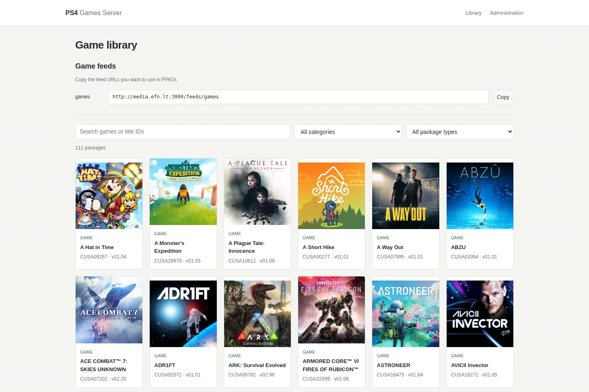
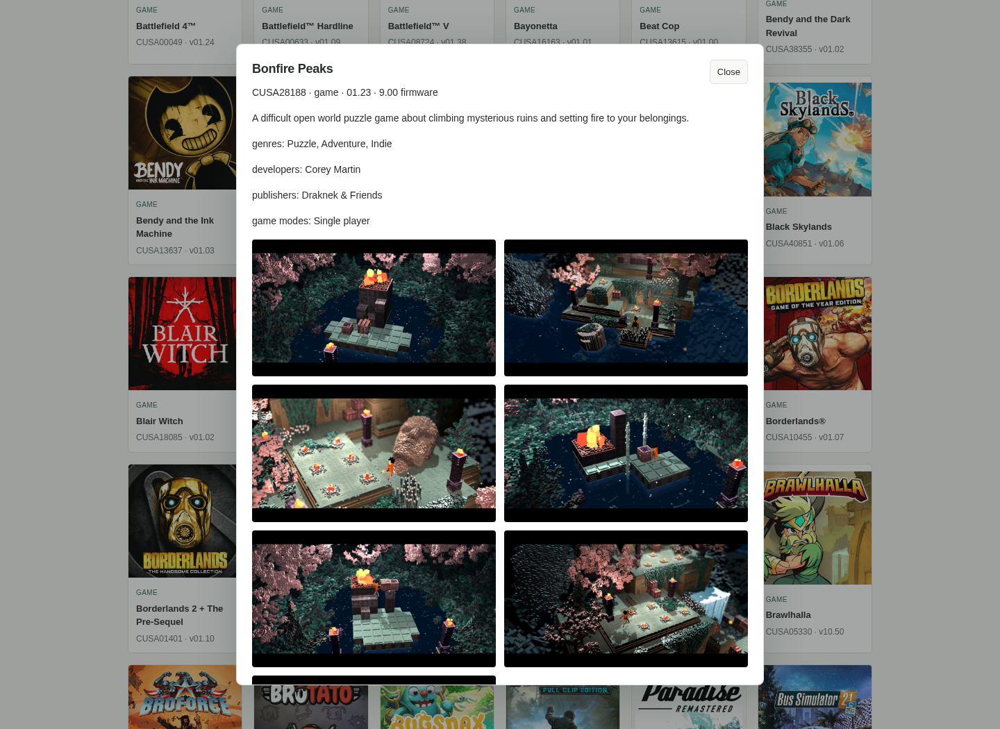
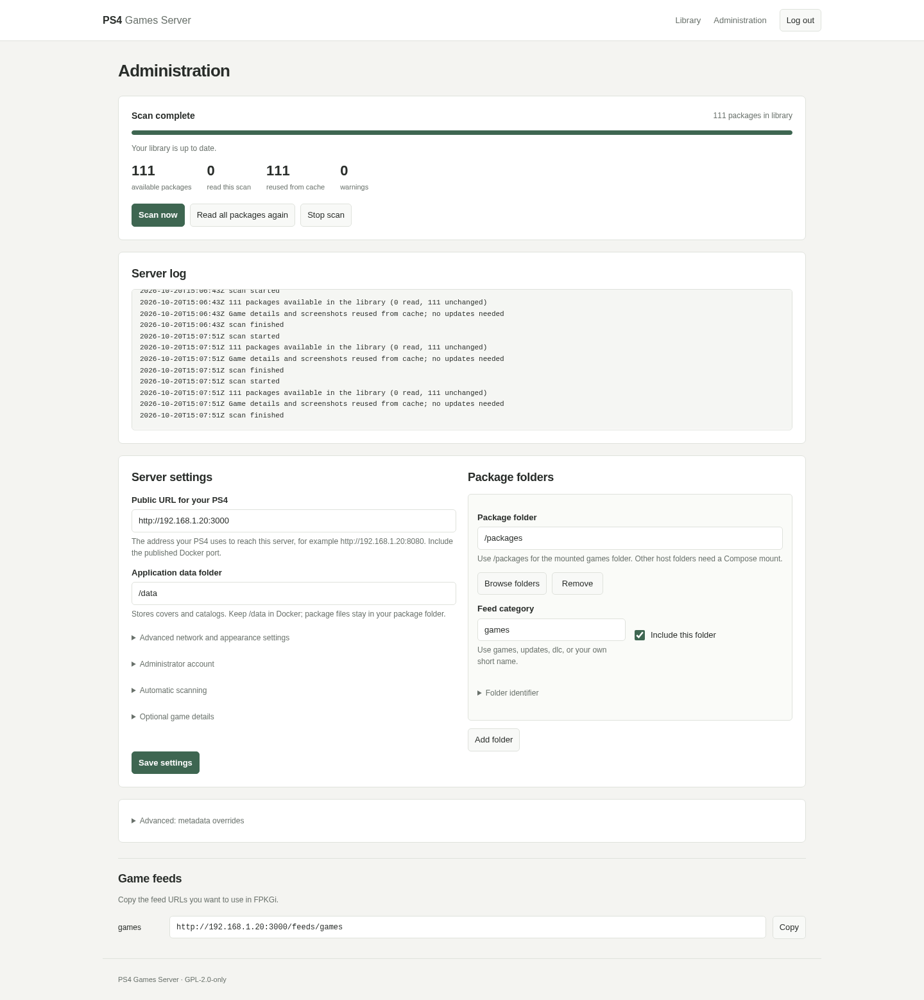

# PS4 Games Server

[](https://github.com/e1z0/PS4-Games-Server/actions/workflows/ci.yml)

Keep your PS4 `.pkg` files on a PC or NAS and browse them from your PS4. **PS4 Games Server is designed especially for [PS4 Games Installer](https://github.com/e1z0/PS4-Games-Installer)**: it creates the game catalog and serves the packages, covers, descriptions and screenshots that the installer displays. FPKGi-compatible clients can use its feeds too.

You can also browse the whole library in a web browser. The server runs as one executable on Windows, Linux or macOS, or in Docker on a NAS. No database or additional runtime is needed for the executable.

## A look inside

**Library:** search your collection, filter games, updates and DLC, and copy Game feed URLs. Captured from the running server with a populated library.

[](docs/screenshots/library.png)

**Game details:** open a game to see its description, package information and screenshots. Rich details and screenshots use optional IGDB integration.

[](docs/screenshots/game-details.png)

**Administration:** manage folders, run scans and follow one scrolling log. Captured with example settings; passwords and API secrets are not shown.

[](docs/screenshots/admin.png)

## What it does

- **Organizes your packages.** Scans folders and subfolders, reads PS4 titles, versions and minimum firmware, and distinguishes games, updates and DLC.
- **Adds artwork and details.** Extracts available package covers. Optional IGDB adds descriptions, screenshots, genres, ratings and other game information; downloaded screenshots stay on your server.
- **Keeps the library current.** Scan manually or on a schedule. Unchanged packages and cached materials are reused; missing or damaged images can be repaired. Games appear before optional online details finish.
- **Shows what is happening.** The web page shows loading and scan progress. Administration has scan controls, settings and a live log.
- **Feeds your PS4.** Copy a category's Game feed URL into PS4 Games Installer. Downloads support resuming; browser administration uses a separate login.

You supply the package files and a PS4 capable of running PS4 Games Installer. Keep the server running while browsing or downloading from it.

## Start on a PC

1. [Download a release](https://github.com/e1z0/PS4-Games-Server/releases) for your computer and unpack it. Most Intel/AMD PCs use **amd64**; Apple Silicon and ARM machines use **arm64**.
2. **Windows:** double-click `ps4-server.exe`. **Linux/macOS:** open a terminal in the unpacked folder and run `./ps4-server`.
3. Open the complete **Setup** link printed in the window, including `#token=...`. Follow the short setup steps below.

Leave the server window open. See the [Windows guide](WINDOWS.md) for a full example, firewall help and optional automatic Windows service.

## Start on a NAS with Docker

This example uses the same folder layout as the running NAS. Your packages stay in `/volume1/Games/_PS4/games`; configuration and generated artwork are stored separately.

1. Install Docker / Container Manager. Create the `config` and `data` folders shown below, and give the account running the container write access to both. It needs read access to the packages folder. See the [folder permission example](EXPERT.md#docker-ownership-updates-and-health) if needed.
2. Save [this Compose file](examples/compose.nas.yml) as `/volume1/docker/ps4-games-server.yml`. Change `192.168.1.20` to your NAS's LAN address. `1026:100` is an example user/group ID pair; use your account's IDs (the `id` command shows them).

```yaml
services:
  ps4-server:
    image: nulldevil/ps4-games-server:0.1.0-dev
    container_name: ps4-games-server
    user: "1026:100"
    ports:
      - "3000:8080"
    environment:
      PS4_LISTEN: :8080
      PS4_DATA_DIR: /data
      PS4_PUBLIC_URL: http://192.168.1.20:3000
      PS4_SCAN_STARTUP: "true"
      PS4_SCAN_INTERVAL_MINUTES: "5"
      PS4_MAPPINGS: '[{"id":"games","path":"/packages","category":"games","enabled":true}]'
    volumes:
      - /volume1/Games/_PS4/games:/packages:ro
      - /volume1/docker/dockers/ps4gamesserver/config:/config
      - /volume1/docker/dockers/ps4gamesserver/data:/data
    restart: unless-stopped
```

3. From `/volume1/docker`, start it and read the setup link:

```sh
docker compose -f ps4-games-server.yml up -d
docker compose -f ps4-games-server.yml logs -f
```

On Synology with the older Compose command, use `sudo docker-compose` in place of `docker compose`. You can also import the file as a Container Manager project and open its logs. Pressing Ctrl+C exits the log viewer; the container keeps running.

4. Open the printed Setup link. When opening it from your PC, replace `localhost:8080` with `192.168.1.20:3000`, keeping the `/setup#token=...` part. Use your actual NAS address.

Your files will look like this:

```text
/volume1/
├── Games/_PS4/games/                   # Your existing packages; read-only in Docker
│   ├── Example Game/game.pkg
│   ├── Example Game/update.pkg
│   └── Other Game/game.pkg
└── docker/
    ├── ps4-games-server.yml            # The Compose file above
    └── dockers/ps4gamesserver/
        ├── config/
        │   └── config.json            # Saved settings; created by setup
        └── data/                      # Created and maintained by the server
            ├── catalogs/games.json    # Game feed
            ├── covers/games/          # Package covers
            ├── covers/igdb/screenshots/ # Downloaded screenshots, grouped by Title ID
            ├── scan-cache.json        # Saved package details
            ├── metadata-cache.json    # IGDB details and image validation cache
            └── metadata-overrides.json # Optional manual game information
```

In the wizard, Docker's package folder is **`/packages`** and its data folder is **`/data`**. These refer to the NAS folders mounted above. All packages in this example share the `games` feed; the package type still identifies updates and DLC. Back up both `config` and `data` to keep your settings and downloaded materials.

## Finish setup and connect your PS4

1. **Account:** choose your admin username and a password of at least 12 characters.
2. **Folders:** select your package folder. For the NAS example, keep `/packages` and category `games`.
3. **Connection:** enter the address your PS4 can reach: `http://192.168.1.20:8080` for a PC, or `http://192.168.1.20:3000` for the NAS example. In Docker, keep data storage at `/data`.
4. **Scanning:** enable startup scans and choose an automatic interval, or use `0` for manual scans.
5. **Game details:** optionally enter IGDB credentials for descriptions and screenshots. You can skip this and enable it later; see [IGDB setup](EXPERT.md#optional-igdb-details).
6. **Save and start:** sign in, open Administration and choose **Scan now** if a scan has not already started. Browse **Library** while it fills up.

In the library, click **Copy** beside the `games` URL under **Game feeds**. On your PS4, open **PS4 Games Installer → Options → Settings**, paste it into **Games JSON URL**, then choose **Test connection** and **Save settings**. For the NAS example the URL is:

```text
http://192.168.1.20:3000/feeds/games
```

Use your own server address. Your PC/NAS and PS4 need to reach each other on the network; allow the server port through the computer's firewall. Only administration needs your login—feeds and downloads are accessible to devices that can reach the server.

## More help

- [Windows walkthrough and automatic service](WINDOWS.md)
- [Expert guide](EXPERT.md): IGDB, extra folders, configuration, backups and troubleshooting.
- [Developer guide](DEVELOPER.md): source builds, tests, releases and publishing.
- [Changelog](CHANGELOG.md) · [GPLv2 license](LICENSE) · [Third-party notices](THIRD_PARTY_NOTICES.md)
